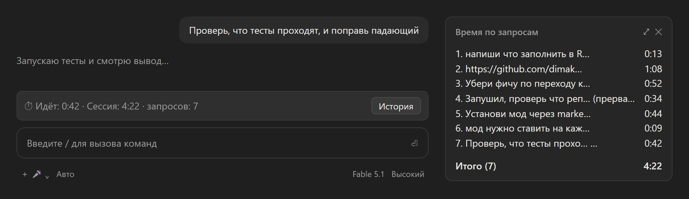
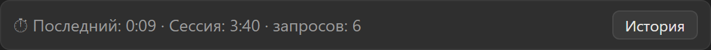
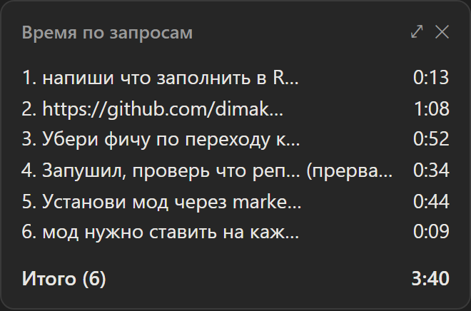
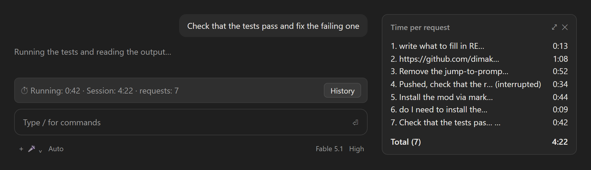
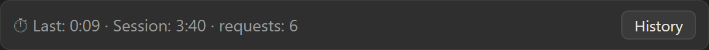
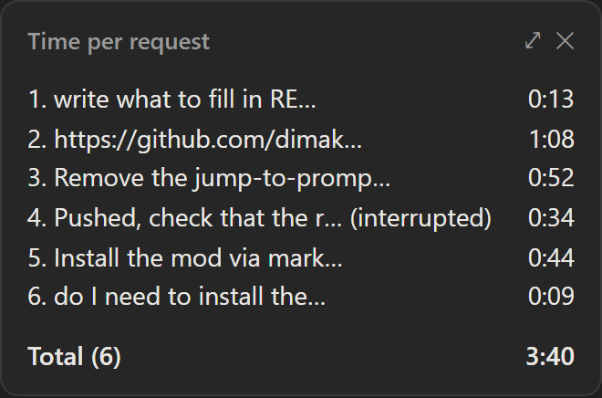

# tickturn

Русский · [English](#english)

Мод для [Claude Code](https://claude.com/claude-code), который показывает, сколько времени Claude потратил на каждый запрос и на всю сессию.



- **Полоса над полем ввода** — живой таймер, пока ход идёт (`⏱ Идёт: 0:42 · Сессия: 4:22 · запросов: 7`), и время последнего хода в покое.
- **Панель истории** (`/time` или кнопка **История**) — все запросы сессии с длительностью и итогом.
- Прерванные ходы помечаются `(прервано)`, завершившиеся ошибкой — `(ошибка)`. `/clear` сбрасывает историю.

Работает в терминале и в десктопном приложении Claude.

| В покое | Панель истории |
| --- | --- |
|  |  |

## Установка

В терминале:

```
/plugin install tickturn --marketplace dimakotov1c/tickturn
```

Ответьте `y`, чтобы добавить marketplace, и выберите область **user** — тогда мод загрузится во всех проектах.

### Из локальной папки

```bash
claude plugin marketplace add /path/to/tickturn
claude plugin install tickturn@tickturn
```

Или только на одну сессию:

```bash
claude --plugin-dir /path/to/tickturn
```

## Как это работает

Мод — это модуль хуков (`hooks/register.tsx`):

- `turn.start` / `turn.complete` — измеряют каждый ход главного цикла (`durationMs` от движка); ходы субагентов отдельно не считаются.
- `ui.render` на `AbovePrompt` и `Pane` — рисуют полосу и историю.
- Состояние живёт в `$.state` (`types/index.d.ts` — его контракт) и переживает горячую перезагрузку модуля в пределах сессии.

## Разработка

```bash
claude plugin validate .
```

Проверка типов — `tsc -p .` после того, как движок положит типы в `.claude-plugin/types/` (он делает это при первой загрузке).

Сценарии ручной проверки — в [docs/test-prompts.md](docs/test-prompts.md).

## Лицензия

MIT

---

# English

[Русский](#tickturn) · English

A [Claude Code](https://claude.com/claude-code) mod that shows how much time Claude spent on each request and on the whole session.



- **Band above the prompt** — a live timer while a turn runs (`⏱ Running: 0:42 · Session: 4:22 · requests: 7`), the last turn's time when idle.
- **History pane** (`/time` or the **History** button) — every request of the session with its duration and the total.
- Interrupted turns are marked `(interrupted)`, failed ones `(error)`. `/clear` resets the history.

Works in the terminal and in the Claude desktop app. The mod's own labels are currently in Russian; the screenshots below are translated.

| Idle | History pane |
| --- | --- |
|  |  |

## Install

In a terminal:

```
/plugin install tickturn --marketplace dimakotov1c/tickturn
```

Answer `y` to add the marketplace, then pick the **user** scope so the mod loads in every project.

### From a local folder

```bash
claude plugin marketplace add /path/to/tickturn
claude plugin install tickturn@tickturn
```

Or for one session only:

```bash
claude --plugin-dir /path/to/tickturn
```

## How it works

The mod is a hooks module (`hooks/register.tsx`):

- `turn.start` / `turn.complete` — measure each main-loop turn (`durationMs` from the engine); subagent turns are not counted separately.
- `ui.render` on `AbovePrompt` and `Pane` — draw the band and the history.
- State lives in `$.state` (`types/index.d.ts` is its contract) and survives hot reloads of the module within a session.

## Development

```bash
claude plugin validate .
```

Type-check with `tsc -p .` once the engine has laid the types into `.claude-plugin/types/` (it does so on the first load).

Manual test scenarios: [docs/test-prompts.md](docs/test-prompts.md) (in Russian).

## License

MIT
